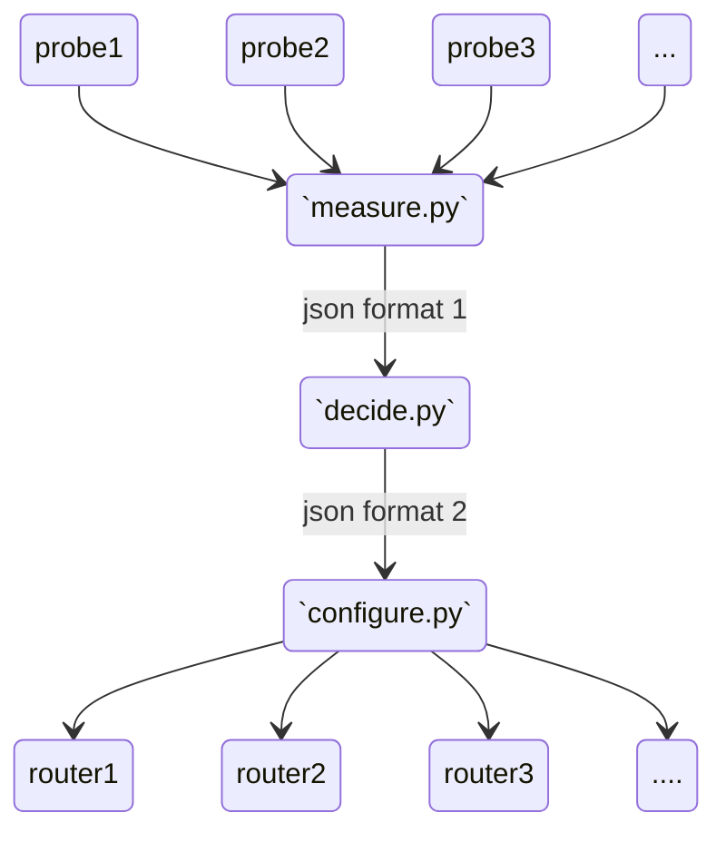

# Orchestrator Project
Welcome to our SDWAN orchestrator project

To create the topology do :
```bash
mkdir ../sdwlab
cp lab_test.py ../sdwlab
cp config.py ../sdwlab
cd ../sdwlab
python lab_test.py
```

We thought of doing something like this 



## Scenari
We imagine different scenari : 
#### Scenario 1
 - `measure.py` asks for isp1 and isp2 to measure latency and sends it to `decide.py`.
 - `decide.py` chooses what BGP attributes to change and sends his decisions to `configure.py`
 - `configure.py` sends the updates to the isp's
FOLLOW-UP : implement this mechanism for all links and for different metrics

#### Scenario 2
 - `measure.py` asks for isp1 and isp2 to measure some data **over time** and sends it to `decide.py`
 - `decide.py` sets the BGP attributes **anticipating** a degradation of QoS.
 - `configure.py` sends the udpates to the isp's
FOLLOw-UP : implement this for different time scale (annual, monthly, daily, reactivly, ...)

#### Scenario 3
 - `measure.py` finds the fastest links
 - based on a QoS preference `decide.py`, choose a link over another one.
 - `configure.py` sends the updates to the isp's