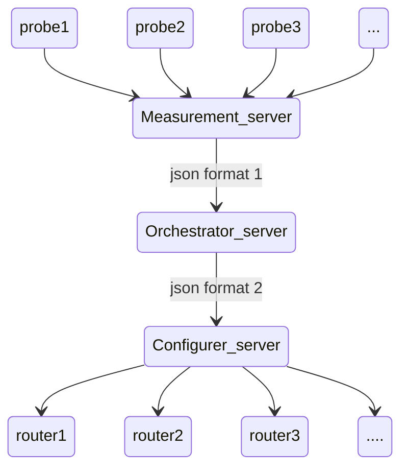

# Orchestrator Project
Welcome to our SDWAN orchestrator project

To create the topology do :
```bash
mkdir ../sdwlab
cp lab_test.py ../sdwlab
cp config.py ../sdwlab
cd ../sdwlab
python lab_test.py
```

We thought of doing something like this 



